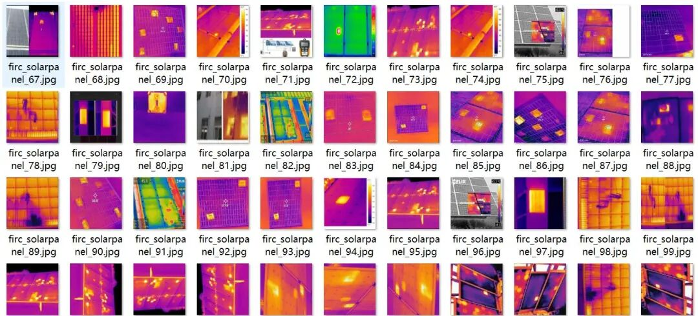
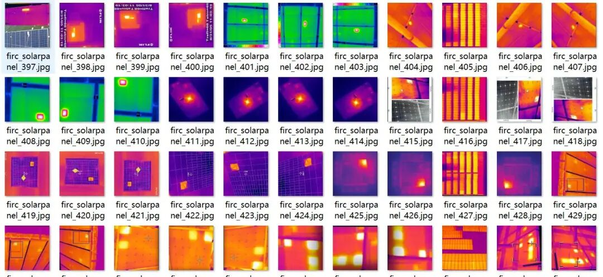
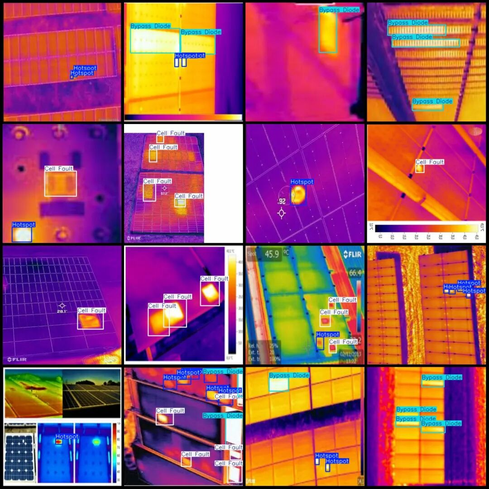

# UAV-Viewpoint Infrared Photovoltaic Solar Panel Bypass Diode Unit Fault Hotspot Defect Detection Dataset in VOC+YOLO format with 2187 images across 4 categories

Dataset format: Pascal VOC format + YOLO format (txt file without split path, only containing jpg images and corresponding VOC format xml files and yolo format txt files)

Number of images (number of jpg files): 2186

Number of annotations (number of xml files): 2186

Number of annotations (number of txt files): 2186

Labeling category count: 4

Label category names (note that the order of labels in the YOLO format does not correspond to this, but is based on the classes.txt file in the labels folder): ["Bypass Diode", "Cell Fault", "Defects", "Hotspot"]

Number of boxes labeled in each category:

Bypass Diode (Bypass Diode) Frame Count = 1472

Cell Fault (battery cell fault) Frames = 3060

Defects (defects) Frame Count = 5

Hotspot (heat spot) frame count = 3207

Total frame count: 7744

Is the dataset enhanced: Yes, about 1/3 is original images, with the rest being enhanced images mainly rotation enhancement.

Image resolution: 416x416

Using labelImg:

Annotation rules: Draw a rectangle around the category.

Important Notice: No

Drone: DJI MAVIC 3

Collection height: 2-10m

Sampling angle: 90°

Special : This dataset does not guarantee the accuracy of the trained models or weight files.

Image Preview:

Annotation example:

## Payment

Here is a pay link on Stripe ( https://buy.stripe.com/3cs8yP7sY87d0vu9AB ). Please contact me lonlonago@foxmail.com after funding $89, and I will send you a complete data files , thank you!

